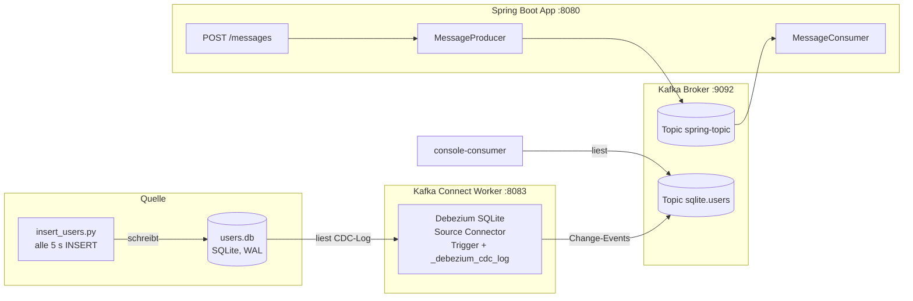

# Kafka Demo Projekt — Übersicht

> **⚠️ Agentic-AI-Disclaimer:** Dieses Projekt dient ausschließlich Demo-Zwecken und ist nicht für den
> Produktiveinsatz bestimmt. Es wurde mit Hilfe von agentic AI erstellt — Architektur und Anweisungen
> stammen vom Repo-Inhaber. Siehe auch das [Root-README](../README.md).

Dieses Projekt ist eine lokale Testumgebung für **Apache Kafka** mit zwei unabhängigen Datenquellen und Konsumenten:

1. **CDC-Pipeline**: Eine SQLite-Datenbank wird über einen Debezium-Kafka-Connect-Source-Connector auf Änderungen überwacht; Insert-, Update- und Delete-Events landen im Topic `sqlite.users`.
2. **Spring-Boot-Anwendung**: Producer/Consumer mit JSON-Serialisierung auf dem Topic `spring-topic`.

## Komponenten

| Komponente | Ort | Beschreibung |
|---|---|---|
| Apache Kafka 4.4.0 (KRaft) | `kafka/` *(nicht Teil des Repos — lokal entpackt, [Download](https://kafka.apache.org/downloads))* | Broker (Port 9092) + Kafka Connect Worker (Port 8083) |
| Spring-Boot-App | `kafka.demo/` | Spring Boot 4.1.2, Java 27, `POST /messages` → `spring-topic` |
| SQLite-Datenbank | `users.db` *(Laufzeitdatei, nicht im Repo)* | Tabelle `users`, WAL-Modus |
| Writer-Script | `insert_users.py` | Schreibt alle 5 s eine Row in `users.db` |
| Debezium-SQLite-Connector | externes Projekt [debezium/debezium-connector-sqlite](https://github.com/debezium/debezium-connector-sqlite) *(nicht Teil des Repos — lokal geklont & gebaut)* | Quellen-Connector, Stand 3.8.0-SNAPSHOT (incubating) |
| Connect-Worker-Config | `connect-standalone-sqlite.properties` | Standalone-Konfiguration |
| Connector-Config | `sqlite-users-connector.json` | Registrierung des CDC-Connectors |
| Dokumentation | `docs/` | Dieses Verzeichnis |

## Gesamtarchitektur



## Quick Start (Reihenfolge beachten)

```bash
cd ~/Documents/repos/kafka-demo

# 0. Kafka-Distribution bereitstellen (einmalig, nicht Teil des Repos):
#    Apache Kafka 4.4.0 von https://kafka.apache.org/downloads herunterladen
#    und nach kafka/ entpacken; Debezium-Connector bauen, siehe setup.md

# 1. Broker starten (falls nicht laufend)
kafka/bin/kafka-server-start.sh kafka/config/server.properties

# 2. Connect-Worker starten (optional, nur für CDC)
kafka/bin/connect-standalone.sh connect-standalone-sqlite.properties sqlite-users-connector.json

# 3. SQLite-Writer starten (optional, nur für CDC)
python3 insert_users.py

# 4. Spring-Boot-App starten
cd kafka.demo && ./mvnw spring-boot:run

# 5. Testen
curl -X POST localhost:8080/messages -H "Content-Type: text/plain" -d "hello"   # → spring-topic
kafka/bin/kafka-console-consumer.sh --bootstrap-server localhost:9092 --topic sqlite.users --from-beginning
kafka/bin/kafka-console-consumer.sh --bootstrap-server localhost:9092 --topic spring-topic --from-beginning
```

Alle Prozesse laufen im Vordergrund und werden mit `Ctrl+C` beendet.

## Ports

| Port | Dienst |
|---|---|
| 9092 | Kafka Broker (PLAINTEXT) |
| 9093 | Kafka Controller (KRaft-Quorum) |
| 8083 | Kafka Connect REST-API |
| 8080 | Spring Boot (Tomcat) |

## Dokumentations-Index

- [architecture.md](architecture.md) — Architektur, Datenfluss, Verzeichnisstruktur
- [kafka-installation.md](kafka-installation.md) — Vollständige Doku des `kafka/`-Verzeichnisses
- [setup.md](setup.md) — Voraussetzungen und Umgebung
- [sqlite-source.md](sqlite-source.md) — SQLite-Datenbank und Writer-Script
- [kafka-connect-cdc.md](kafka-connect-cdc.md) — CDC-Pipeline im Detail
- [spring-boot-app.md](spring-boot-app.md) — Die Spring-Boot-Anwendung
- [troubleshooting.md](troubleshooting.md) — Bekannte Fehler und Lösungen
