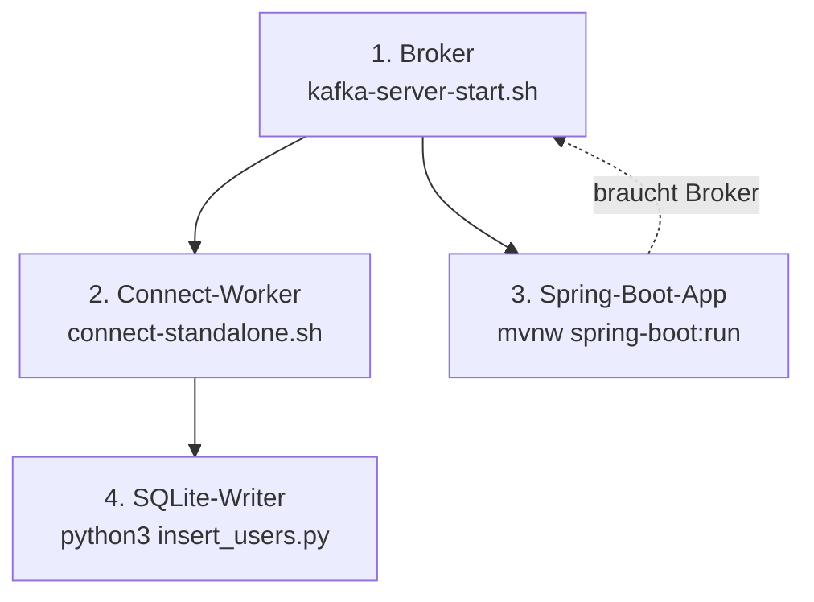

# Setup und Umgebung

## Voraussetzungen

| Tool | Benötigte Version | Ist installiert |
|---|---|---|
| Java (JDK) | 17+ für Connect/Debezium; **27** für das Spring-Boot-Projekt | `/usr/lib/jvm/java-latest-openjdk` (27-ea) |
| Maven | 3.9+ (oder Maven-Wrapper des Projekts) | System-mvn 3.9.11 + `mvnw` 3.10.0 |
| Python 3 | 3.x (nur Stdlib) | 3.14 |
| sqlite3 CLI | 3.x | 3.51.2 |
| git | für den Connector-Clone | ✓ |
| curl | für Connect-REST-API | ✓ |

## JAVA_HOME für System-Maven (wichtig!)

Das Fedora-Maven-Paket startet mit **Java 25** — das Projekt braucht aber **Release 27**, sonst bricht der Build ab:

```
error: release version 27 not supported
```

Lösung: `~/.mavenrc` (wirkt nur für Maven, nicht für andere Tools):

```bash
# ~/.mavenrc
JAVA_HOME=/usr/lib/jvm/java-latest-openjdk
```

Prüfen:

```bash
mvn -version    # muss "Java version: 27-ea, runtime: /usr/lib/jvm/java-latest-openjdk" zeigen
```

Alternative: Der Maven-Wrapper `./mvnw` (im `kafka.demo/`-Verzeichnis) wählt Java selbst über `PATH` und funktioniert auch ohne `.mavenrc`.

Hinweis: `/usr/lib/jvm/java-27-openjdk` ist auf diesem System ein leeres Stub-Verzeichnis — die echte Java 27 liegt unter `java-latest-openjdk`.

## Externe Komponenten bereitstellen (einmalig, nicht Teil des Repos)

Vor dem ersten Start müssen zwei externe Komponenten lokal bereitgestellt werden:

### Schritt 0a: Kafka-Distribution entpacken

```bash
cd ~/Documents/repos/kafka-demo
# Apache Kafka 4.4.0 (Scala 2.13) von https://kafka.apache.org/downloads laden und entpacken:
tar -xzf kafka_2.13-4.4.0.tgz
mv kafka_2.13-4.4.0 kafka    # → das kafka/-Verzeichnis, das die Doku durchgehend verwendet
```

### Schritt 0b: Debezium-SQLite-Connector klonen, bauen und installieren

Quelle: <https://github.com/debezium/debezium-connector-sqlite> (wird per `.gitignore` aus dem Repo gehalten).

```bash
cd ~/Documents/repos/kafka-demo
git clone https://github.com/debezium/debezium-connector-sqlite.git
cd debezium-connector-sqlite
mvn clean package -Passembly -DskipTests
# → target/debezium-connector-sqlite-3.8.0-SNAPSHOT-plugin.tar.gz
mkdir -p ../kafka/connect-plugins
tar -xzf target/debezium-connector-sqlite-3.8.0-SNAPSHOT-plugin.tar.gz -C ../kafka/connect-plugins/
```

Der Build dauert einige Minuten (SNAPSHOT-Dependencies von Maven Central Snapshots werden gezogen; Java 17+ erforderlich).

## Start-Reihenfolge



Nur der Broker ist harte Pflicht für alles Andere. Worker und App sind voneinander unabhängig; der Writer braucht nur die DB-Datei.

## Connectivity-Checks

```bash
# Broker erreichbar?
kafka/bin/kafka-broker-api-versions.sh --bootstrap-server localhost:9092 >/dev/null && echo UP

# Ports hören?
ss -ltn | grep -E '9092|9093|8083|8080'

# Connect-Worker erreichbar?
curl -s localhost:8083 | jq .   # liefert version/commit
```
